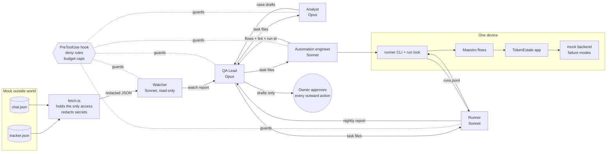

# QA Agents Demo: an agentic QA team on a mock mobile app

Five Claude agents (QA Lead, Watcher, Analyst, Automation engineer, Runner) run an end-to-end test process on **TokenEstate**, a mock mobile app for fractional, tokenized real-world assets. The point is the *process*: narrow tools, evidence-based handoffs, a human who approves every outward action, and defences against prompt injection that do not rely on the model behaving.

Everything is fake: the app, the backend, the tickets, the chat. It needs no company access and no device to demo.

## 5-minute quickstart

Prerequisites: **Node 22.18 or newer** (the TypeScript scripts run directly, no build) and `bash`. Nothing to install for the demo itself.

```bash
git clone https://github.com/<your-user>/agentic-qa-team-demo && cd agentic-qa-team-demo
./scripts/demo.sh
```

That runs the whole story in *recorded* mode in about 10 seconds, offline:

1. checks the team definition, the safety hook and the unit tests;
2. reproduces the backend's failure modes (OTP delayed, payment declined, duplicate webhook);
3. lints the Maestro flows, and shows a bad flow being rejected;
4. runs two nightly regressions and writes the **nightly report** (failure classes + evidence);
5. shows the run lock refusing a second driver;
6. fetches mock tracker and chat data, **redacts a planted fake token**;
7. shows the **Watcher's "what changed" report**, which quotes two planted prompt injections as data and does not act on them;
8. shows the **Analyst's case draft** with a named source per step;
9. adds a **new flow** from the Automation engineer that passes lint and a run;
10. shows the **Lead's review rejecting a handoff** that has no evidence, derived by code;
11. prints the **cost log** and runs the privacy check.

Useful options: `./scripts/demo.sh --pause` (wait for Enter between steps, for presenting) and `./scripts/demo.sh --agents` (see below). The presenter script is in [docs/demo-script.md](docs/demo-script.md). One finished run is committed in [docs/example-output/](docs/example-output/).

## Architecture



## What is in the repo

| Path | What |
|---|---|
| `app/` | Expo (React Native) app, every interactive element has a kebab-case `testID` |
| `mock-backend/` | Node mock backend with switchable failure modes, unit-tested |
| `e2e/` | 10 Maestro flows with headers (case id, tickets, tags), shared subflows, suites (`smoke`, `regression`), owner-only smoke allowlist |
| `runner/` | TypeScript runner: `lint`, `list`, `run`, `report`, `lock`; writes `results/runs.jsonl` with failure class `app/selector/env/test/driver`; recorded-run mode |
| `.claude/agents/` | The five agents (model, tool allowlist, trigger, budget) |
| `.claude/settings.json`, `.claude/hooks/` | Deny rules and the `PreToolUse` guard |
| `docs/qa-team/` | Roster, per-role permission files, handoffs, reports, run lock, cost log |
| `fixtures/`, `scripts/fetch.ts` | Mock Jira/Slack data and the redacting fetch step |
| `samples/` | Recorded agent outputs used by the offline demo |
| `docs/design.md`, `docs/safety.md`, `docs/seeded-bugs.md`, `docs/demo-script.md` | Design, safety model, the two seeded bugs, interview walkthrough |

## Recorded vs live

| | Recorded (default) | Live |
|---|---|---|
| Test runs | Replays `runner/recordings/*.json` through the real runner, classifier, lock, lint and report code | `node runner/src/cli.ts run --suite regression --mode live` runs `maestro test` against the app on a booted simulator, with the mock backend running |
| Agent steps | Pre-written sample outputs in `samples/`, checked by the real Lead script | `./scripts/demo.sh --agents` runs each role headless via `scripts/run-agent.sh` (needs the `claude` CLI and `ANTHROPIC_API_KEY` in the environment; the key is never read from a file) |
| Cost log | Illustrative placeholder rows, labelled `recorded` | Measured rows labelled `live` |

Live device run, step by step: `cd app && npm install && npx expo run:ios`, then `node mock-backend/server.mjs`, then the runner command above. Needs [Maestro](https://docs.maestro.dev) and Xcode with a simulator.

## Safety model (short)

Agents draft, the owner decides and sends. Layers: narrow tool allowlists (the Watcher has no Bash and no network); per-role permission files; project deny rules; a `PreToolUse` hook that blocks dangerous commands, owner-only files, device use while locked, and outward actions unless the owner approved that one action; a fetch step that is the only code touching the tracker and chat and redacts secrets; a run lock; budget caps; and a Lead that re-derives evidence instead of trusting summaries. Details and the planted attacks: [docs/safety.md](docs/safety.md).

## Honest limits

- **Recorded mode is a replay.** The runner, classifier, lock, lint, report, fetch, redaction and Lead checks are real code. The agent outputs in `samples/` are written by hand in the style of the agents; they are not fresh model output. Only `--agents` produces fresh output.
- **Not verified here:** the `--agents` mode and a live Maestro run on a simulator were not exercised. The Expo app type-checks (`cd app && npm install && npm run typecheck` passed when this was written) but has never been run on a device or simulator.
- The failure classifier is a handful of regular expressions: it suggests, a person confirms. It will misclassify. The recorded `invest-001` case is a deliberate example.
- The injection defences are layered, not proof. The strongest ones are structural (no tools to act with). Prompt wording and the heuristic flagging in `fetch.ts` are weaker. A determined attacker with write access to a tool an agent legitimately has could still do damage inside that tool's scope.
- The hook uses pattern matching on commands, so it is conservative: it can block harmless commands that merely contain a blocked word, and it is not a sandbox. Use OS-level isolation for anything real.
- Costs in the log are placeholders unless the mode is `live`; token prices in `docs/qa-team/prices.json` are placeholders too.
- One mock app, one platform in the recordings, ten flows: it is a teaching demo, not a benchmark.

## Privacy

`scripts/privacy-check.sh` scans the repo for company or personal identifiers, tracker keys of real projects, secrets, non-placeholder URLs and e-mail addresses, and image files. Add your own terms to `.privacy-terms.local` (git-ignored). Run it before every push.
